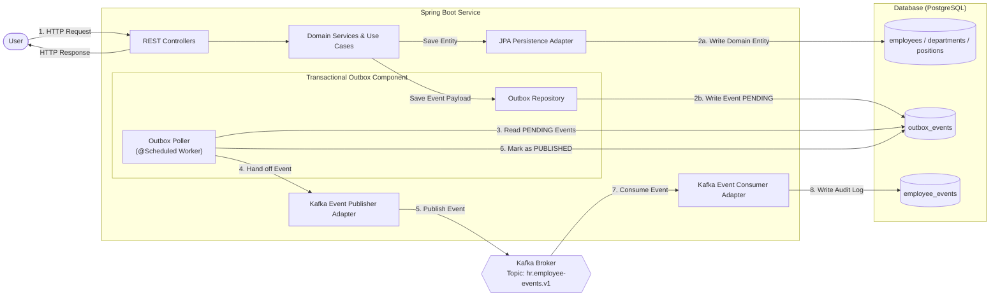

# HR Management System

Este é um desafio técnico para uma vaga de Engenheiro(a) de Software Sênior. 

## Links
- [Quick Start](QUICK_START.md): Instruções para subir a aplicação em seu ambiente
- [AI Usage](AI_USAGE.md): Declaração de uso de IA.

## Endpoints

- Swagger UI: http://localhost:8080/swagger-ui.html
- OpenAPI Docs: http://localhost:8080/api-docs
- Spring Actuator Health: http://localhost:8080/actuator/health
- Spring Actuator Metrics: http://localhost:8080/actuator/metrics
- SonarQube Dashboard: http://localhost:9000 (Default login: admin / admin)


## 1. Definindo passo a passo

1. Definir os requisitos técnicos e funcionais do sistema;
2. Dados os requisitos, criar a arquitetura high level da solução;
3. Definir os contratos (payloads ou schemas de banco de dados);
4. Realizar um Review da Arquitetura e com esta análise realizar as alterações que julgar necessário;

``` A definição da arquitetura e requisitos técnicos é fundamental antes de começar a configuração e implementação dos serviços.```

5. Criar a configuração do Dockerfile com os requisitos técnicos;
6. Criar o *scaffold* da estrutura do projeto + testes;
7. Criar as entidades de domínio e testes simples para apenas validar o projeto;
8. Configurar o Github Actions para criar uma pipeline que realizará a build, Sonar e rodar testes para cada PR;
9. Realizar um commit inicial de teste;

``` Acredito que este commit inicial sem muita lógica de negócios, integrações com API/Kafkas/SQL facilita a identificação de erros de integração quando cada peça for acoplada nos futuros commits.```

10. Configurar boas práticas a serem seguidas pelo copilot;
11. A partir daqui, utilizar IA para auxiliar na implementação de cada requisito funcional do sistema. Começando pela camada de negócios e depois a integração com API, DB e Kafka. Deve ser feito um requisito de cada vez.

``` Implementar um requisito funcional de cada vez permite a melhor análise e teste de cada parte do sistema e evita perda de escopo.```

### Uso de IA
Todo uso de IA será documentado na página [AI Usage](AI_USAGE.md).

## 2. Requisitos Funcionais e Técnicos 

Após a leitura do desafio e análise dos requisitos do desafio, com o auxílio da IA, mapeei os requisitos técnicos e funcionais, assim como os domínios. 

### 2.1. Requisitos Funcionais 

#### **RF-01: Gestão de Departamentos**
- Cadastrar Departamento (`POST /departments`) com id, name, costCenterCode.

**Regra de Domínio:** Departamentos devem ter nome único.<br>

```
Department (table = department) {
    id (UUID) PK, 
    name (string), 
    costCenterCode (string), 
    createdAt (timestamp)
}
```

#### **RF-02: Gestão de Cargos**
- Cadastrar Cargo (`POST /departments`) com id, title, level (ex: Junior, Pleno, Senior).

```
Position (table = department) {
    id (UUID) PK, 
    title (string), 
    level(string), 
    createdAt (timestamp)
}
```


#### **RF-03: Gestão de Colaboradores**
- Cadastrar Colaborador (`POST /employees`) vinculando a um departamento e cargo existentes.   
    **Regra de Domínio:** O campo email deve ser validado e único; <br>
    **Regra de Domínio:** O campo status deve ser criado como "CREATED";<br>

- Listar Colaboradores (`GET /employees`).   
    **Requisito Técnico:** Deve ser permitido a paginação dos resultados;<br>

- Inativar Colaborador (`DELETE /employees/{id}`).   
    **Regra de Domínio:** O campo status do Employee deve ser alterado para "DELETED";<br>

- Buscar Colaboradores por Departamento (`GET /employees/search?department={departmentName}`).<br>
    **Requisito Técnico:** Deve ser permitido a paginação dos resultados;<br>

- Ativar Cadastro do Colaborador (`POST /employees/{id}/activate`)<br>
    **Regra de Domínio:** O campo status do Employee deve ser alterado para "INACTIVE", apenas caso o status do funcionário seja "CREATED" ou "ACTIVE";<br>

- Desativar Cadastro do Colaborador (`POST /employees/{id}/deactivate`)<br>
    **Regra de Domínio:** O campo status do Employee deve ser alterado para "ACTIVE", apenas caso o status do funcionário seja "CREATED" ou "INACTIVE";<br>

```
Employee (table = employee) {
    id (UUID) PK,
    name (string), 
    email (string), 
    departmentId (Department FK), 
    positionId (Position FK), 
    status (string), // CREATED, ACTIVE, INACTIVE, DELETED
    createdAt (timestamp), 
    lastUpdatedAt(timestamp),
    deletedAt (timestamp)
}
```

#### **RF-04: Persistir Alterações do Colaborador na Tabela de Outbox Events**
- Ao cadastrar um funcionário, uma entrada na tabela **OutboxEvents** deve ser criada contendo o id do funcionário, timestamp do evento, processingStatus = "PENDING", employeeStatus="CREATED", eventType = "EmployeeCreatedEvent".

- Ao deletar um funcionário, uma entrada na tabela **OutboxEvents** deve ser criada contendo o id do funcionário, timestamp do evento, processingStatus = "PENDING", employeeStatus="DELETED", eventType="EmployeeStatusChangedEvent".

- Caso tenha ocorrido alteração no status, uma entrada na tabela **OutboxEvents** deve ser criada contendo o id do funcionário, timestamp do evento, processingStatus = "PENDING", employeeStatus="ACTIVATED", eventType="EmployeeStatusChangedEvent".

- Caso tenha ocorrido alteração no status, uma entrada na tabela **OutboxEvents** deve ser criada contendo o id do funcionário, timestamp do evento, processingStatus = "PENDING", employeeStatus="DEACTIVATED", eventType="EmployeeStatusChangedEvent".

```
OutboxEvents (table = outbox_events) {
    eventId (UUID) PK,
    employeeId (UUID),
    employeeStatus (string), // CREATED, ACTIVE, INACTIVE, DELETED
    updateTime(timestamp),
    eventType (string), // EmployeeStatusChangedEvent ou EmployeeCreatedEvent
    processingStatus (string), // PENDING, PUBLISHED, FAILED
    createdAt (timestamp),
    publishedAt (timestamp),
    retryCount (int)
}
```

#### **RF-05: Publicar Eventos em  Kafka**

- A aplicação deve checar na tabela OutboxEvents os eventos que ainda estão pendentes e enviá-los.<br>
    **Regra de Domínio:** A mensagem Kafka terá no header **KafkaEmployeeEvent** será enviado tendo como eventId o mesmo da tabela, aggregateId = employeeId e seu payload terá o employeedId e o employeeStatus.<br>
    **Requisito Técnico:** Eventos que foram processados (ACK) devem ser atualizados de "PENDING" para "PUBLISHED". Em caso de exceder o máximo de retries devem ser atualizado para "FAILED".<br>
    **Requisito Técnico:** Deve ser permitido que múltiplas instâncias realizem o poller sem ter mensagens duplicadas (utilizar
SELECT *
FROM outbox_events
WHERE status = 'PENDING'
ORDER BY created_at
LIMIT 100
FOR UPDATE SKIP LOCKED;  por exemplo)<br>

```
KafkaEmployeeEvent (topic = hr.employee-events.v1){
  "eventId": "uuid",
  "eventType": "EmployeeStatusChangedEvent ou EmployeeCreatedEvent",
  "aggregateId": "employee-uuid",
  "occurredAt": "2026-11-10T15:30:00Z",
  "payload": {
    "employeeId": "employee-uuid",
    "status": "ACTIVE"
  }
}
```

#### **RF-06: Manutencão de Histórico**

- A aplicação deve consumir os eventos `EmployeeCreatedEvent` e `EmployeeStatusChangedEvent` e armazená-los no banco de dados. <br>
    **Regra de Domínio:** Olhar definição da entidade EmployeeEvents;<br>
    **Regra de Domínio:** Para o evento `EmployeeCreatedEvent` o eventType deve ser "CREATION" e employeeStatus = "CREATED";<br>
    **Regra de Domínio:** Para o evento `EmployeeStatusChangedEvent` o eventType deve ser "UPDATE" e employeeStatus = "ACTIVE" ou "INACTIVE" ou "DELETED";<br>
    **Requisito Técnico:** O ACK da mensagem deve ser feito apenas após persistência com sucesso.<br>
    **Requisito Técnico:** Verificar se o mesmo eventId já foi processado.<br>

```
EmployeeEvents (table = employee_events) {
    eventId (UUID) PK,
    employeeId (UUID),
    eventTime (timestamp),
    eventType (string), // CREATION, UPDATE
    employeeStatus (string), // CREATED, ACTIVE, INACTIVE, DELETED
}
```

### 2.2. Requisitos Técnicos e de Arquitetura 

#### **RT-01: Arquitetura DDD + Clean Architecture / Hexagonal**
- Separação estrita de camadas (domain, application, infrastructure, interfaces).   
- Domínio agnóstico (sem dependências de frameworks como Spring/JPA no domain).   
- Modelo com Entidades Ricas, Agregados, Value Objects e Domain Services.   

#### **RT-02: Persistência & Versionamento de Banco**
- Uso de Spring Data JPA na camada de infraestrutura.
- PostgreSQL configurado para produção/local dockerizado e H2 para suporte a testes/execução simplificada.- Migrations obrigatórias com Flyway (resources/db/migration).

#### **RT-03: Mensageria & Eventos Assíncronos**
- Publicação/Consumo desacoplados utilizando Apache Kafka.   
- Implementação do Transactional Outbox Pattern para garantir a entrega atômica do evento junto com a persistência em banco.   

#### **RT-04: Qualidade e Testes Automatizados**
- Testes Unitários no Domínio e Aplicação (mínimo de 80% de cobertura).   
- Testes de Integração usando Testcontainers com PostgreSQL e Kafka reais.   
- Testes de Eventos (verificando fluxo completo de publicação e consumo).   

#### **RT-05: Observabilidade e Versionamento**
- Observabilidade com Spring Actuator e logs estruturados em JSON.
- OpenAPI/Swagger documentado com versionamento de API (/v1/... ou via headers).

#### **RT-06: Containerização & CI/CD**
- Dockerfile multi-stage build funcional.   
- docker-compose.yml contendo a aplicação, PostgreSQL e Kafka.   
- Pipeline de CI/CD funcional rodando build e suíte de testes. 

#### **RT-07: Práticas de Engenharia e Transparência com IA**
- Documento AI_USAGE.md preenchido detalhando ferramentas, prompts, decisões arquiteturais e limitações.   
- Commits claros indicando auxílio da IA onde aplicável.   
- Documento README.md completo e ilustrado com Diagrama de Arquitetura (PlantUML/Mermaid).   

## 2.3 Observações Sobre Requisitos

### Employee Status
Ao analisar a solução percebi que o Employee ter um campo "status" e o trecho:
```Ao inativar um colaborador, dispare EmployeeStatusChangedEvent``` indicam a necessidade de um endpoint para alterar o status do Employee após sua criação. <br>

Extrapolei que o status poderia ser: "CREATED", "INACTIVE" e "ACTIVE" e que o funcionário seria criado como PENDING inicialmente. <br>

Ativar e desativar um funcionário pode desencadear em muitas ações além da alteração no banco, seguindo o DDD faria mais sentido, então, dois endpoints: /activate e /deactivate.

## 3. Solution Architecture

Após o entendimento da solução como um todo e a definição dos requisitos, criei com auxílio de IA o diagrama abaixo da arquitetura inicialmente definida:



## 4. Configurando o ambiente

Utilizei a IA para definir qual versão de Java e Spring Boot são mais adequadas para uma melhor compatibilidade com todas integrações, obtendo-se, então:  **Java 21 (LTS) e Spring Boot 3.3.5**.

Com estas definições foi permitido gerar o scaffold da aplicação, a configuração do Docker e a pipeline do Github Actions para build e testes em PR.

